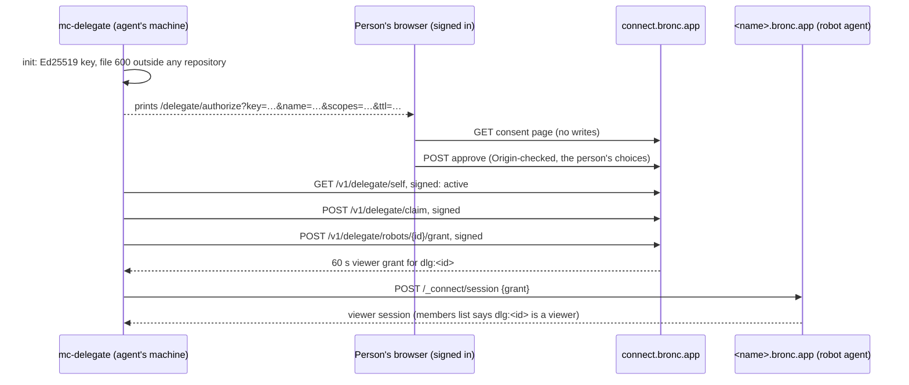

# Delegating to an AI agent

Status: designed 2026-11-11, implemented in the relay and in `delegate/` (the `mc-delegate` CLI
and MCP server). The feature is **off until it is configured**: `DELEGATION_USERS` names the
people who may approve a delegation.

A *delegation* lets a program act for one person on Mowgli Connect with a limited set of rights.
The program is usually an AI agent (Claude in T3 Code or Claude Code), or an automation such as
the Mowgli Simulation Farm. It can list robots and their status, add robots with a pairing code
(above all, simulator robots), rename and unlink them, and read a robot's GUI without changing
anything. It can never drive a mower, run the blade, change settings or edit maps, and it has no
admin rights. Every delegation is approved by the person, in the browser, on a consent page. It
expires, and it can be revoked at once. Everything it does is recorded in an activity log.

In this document, "agent" means the AI agent, and "robot agent" means the `connect-agent` that
runs on a robot.

## Goals

1. **Explicit consent.** A delegation exists only after the person, signed in, approves it on a
   page that shows the agent's name, the fingerprint of its key, the scopes, the robots and the
   expiry.
2. **No bearer secret.** The agent's identity is an Ed25519 key that it keeps in a file of mode
   600 outside any repository. Every call is signed with that key and is valid once, for at most
   60 seconds, for one method, URL and body. Nothing the relay hands out lets a copy of a log act
   as the agent.
3. **Least privilege, enforced in two places.** The relay checks scopes and the robot set on
   every call. A delegate's robot sessions are additionally capped at the `viewer` role by the
   robot itself, so even a relay bug cannot give an agent control of a mower.
4. **Short-lived, revocable, auditable.** The default expiry is 24 hours, the longest is 30 days,
   and only the person can renew. Revoking takes effect at the relay at once, and on robots
   within one poll interval. A per-delegation activity log is shown to the person.
5. **Reuse what exists.** The same signed-request format as robots and app devices, the same
   claim code path and guess budget, the same grants and robot sessions, the same Origin-checked
   browser forms. No change to the robot agent is needed.

## Scopes

| Scope | Allows | Applies to |
|---|---|---|
| `robots:read` | `GET /v1/delegate/robots`: name, label, hostname, role, online, joystick setting, update available | robots in the delegation's robot set |
| `robots:claim` | `POST /v1/delegate/claim` with a pairing code (preview, then confirm). The robot becomes the person's own robot and joins the robot set. | robots whose pairing code the agent has |
| `robots:manage` | set the person's label for a robot; unlink a robot the person owns | robots in the robot set |
| `sessions:readonly` | `POST /v1/delegate/robots/{id}/grant`: a 60-second grant for a **viewer** session on the robot, as the delegate's own identity `dlg:<id>` | robots in the robot set |

An agent can always read its own delegation (`GET /v1/delegate/self`) and revoke it
(`POST /v1/delegate/revoke`).

**The robot set** is the list of robots a delegation may touch:

- the robots the person ticks on the consent page (none are ticked by default), and
- every robot the delegation added itself with `robots:claim`.

A robot leaves the set when it is unlinked by anyone, and the set never follows a robot to a new
owner. Every call also checks that the person is still a member of the robot (and its owner for
unlink) and still has access to Mowgli Connect.

### What can never be delegated

These rights do not exist as scopes, and the relay rejects any scope it does not know:

- **Owner sessions on a robot.** An owner session on the MowgliNext GUI can drive the mower
  (when remote joystick is allowed), call ROS services (blade, motion, emergency), edit maps and
  schedules, change settings, flash firmware, restart containers, and read configuration that
  contains credentials (`/api/settings`). The robot agent's roles are coarse: `owner` is all of
  it. An AI agent can be steered by text it reads (prompt injection, see below), including text
  that robots themselves supply, so it must never hold that power over a machine with a blade.
  For simulators, the Simulation Farm already controls its robots locally and does not need
  Connect for it.
- **Sharing, invitations and admin.** An agent cannot add members, invite people, change robot
  limits or use the admin page.
- **Delegation management.** An agent cannot create, widen or renew a delegation. It can only
  revoke itself. Renewal is a button for the person.
- **App devices and browser sessions.** The delegate API never creates or ends them.

A "hard to grant" owner scope was considered and rejected: the consent page is the only barrier,
and a person who is used to approving an agent would approve the stronger scope just as quickly.
If remote control by an agent is ever needed, it needs its own design: robot-side allow lists per
command, simulator-only robots that the robot agent itself verifies, and a confirmation on the
robot's side, not just at the relay.

### Simulator robots

PR #2 (`feat/simulator-robots`) lets a robot report that it is a simulator (`sim=1`). That flag
is a claim the robot makes about itself, so it cannot be a security boundary on its own: any
robot can say it. The robot set is the boundary instead: a delegation that only ever claims its
own robots and has no ticked robots cannot touch a real mower. Once PR #2 is merged, a second,
cheap safeguard follows: **a delegation may claim only robots that report `sim=1`, unless the
person widens it on the consent page.** It mainly protects against an agent adding a real mower
by mistake (somebody else's, whose code it read somewhere). It is a follow-up because it needs
PR #2's `robots.simulator` column.

## Flow



### 1. Key

`mc-delegate init` creates an Ed25519 key in
`$XDG_CONFIG_HOME/mowgli-connect-delegate/<profile>/key` (by default
`~/.config/mowgli-connect-delegate/default/key`), directory mode 700, file mode 600, and refuses
a location inside a Git working tree. The delegate id is derived from the public key exactly like
a robot id: lowercase base32 of the first 10 bytes of SHA-256 of the raw key, 16 characters. It
is shown as a fingerprint in four groups (`abcd-efgh-ijkl-mnop`). The CLI never prints or logs
the private key.

### 2. Consent

`mc-delegate request` prints a link:

```text
https://connect.bronc.app/delegate/authorize?key=<raw public key, base64url>&name=<agent name>&scopes=robots:read+robots:claim&ttl=86400
```

The link holds only public data, so the relay stores nothing until the person approves. Signed
in, the person sees:

- the agent's name, marked as chosen by the agent, and the key fingerprint, with the instruction
  to compare it with the one the terminal shows;
- each requested scope as a checkbox (ticked; untick to drop it). Scopes that were not requested
  are not offered;
- their robots, each with a checkbox (none ticked). With `robots:manage` requested, the page
  warns that the agent can unlink every ticked robot the person owns, so a real mower should only
  be ticked when needed (with PR #2, the warning can name the robots that are not simulators);
- the expiry: 1 hour, 8 hours, 24 hours (default), 7 days or 30 days;
- a required checkbox, "I started this myself, just now, and the fingerprint matches";
- if this key already has a delegation for this person, what it has now. Approving replaces its
  scopes, its ticked robots and its expiry. Robots it added itself stay in its set.

**Approve** posts the form. The relay checks the Origin like every browser form, validates every
field again, and creates or replaces the delegation. A key that belongs to another person's
delegation is refused. A person may have at most 5 active delegations.

### 3. Signed calls

Every call carries `Authorization: MC-Delegate <jws>`: a compact JWS, header
`{"alg":"EdDSA","typ":"mc-delegate+jwt"}`, claims:

| Claim | Value |
|---|---|
| `iss` | the delegate id |
| `aud` | the relay origin |
| `htm`, `htu` | the method, and the relay origin + path (no query) |
| `bdh` | base64url SHA-256 of the exact request body bytes (of the empty string for GET) |
| `iat`, `exp` | seconds; `exp - iat` at most 60; 30 s clock skew |
| `jti` | random, 22 to 128 characters, accepted once |

`bdh` binds the body: a signature copied from a log, before or after use, cannot carry a
different pairing code or robot id. Bodies are at most 4 KB.

Every call then checks, in this order: the signature and claims (an unknown key or a bad signature
writes nothing); that the delegation is not revoked and has not expired; the jti (single use);
that the person still has access and is still named in `DELEGATION_USERS`; the call's scope; and
the per-delegation rate limit, in the same statement that writes the activity log entry.

### 4. API

| Call | Scope | Result |
|---|---|---|
| `GET /v1/delegate/self` | none | `{delegateId, name, login, scopes, robots, expiresAt}` |
| `GET /v1/delegate/robots` | `robots:read` | `{robots: [{robotId, name, hostname, role, online, joystick, updateAvailable, addedByDelegate}]}` |
| `POST /v1/delegate/claim` | `robots:claim` | body `{code, label?, step: "preview"\|"confirm"}`, as the app API |
| `POST /v1/delegate/robots/{id}/label` | `robots:manage` | body `{label}` (empty clears it) |
| `POST /v1/delegate/robots/{id}/unlink` | `robots:manage` | the robot is unlinked as from the robots page (owner only) |
| `POST /v1/delegate/robots/{id}/grant` | `sessions:readonly` | `{grant, hostname, expiresAt}`: a viewer grant for `dlg:<id>` |
| `POST /v1/delegate/revoke` | none | the delegation ends now |

Errors are JSON `{"error": "<code>"}`: 400, 401 (`invalid_assertion` + `detail`, or
`delegation_expired`, `delegation_revoked`), 403 (`scope_required` + `scope`, `no_access`), 404
(robots outside the set look exactly like unknown robots), 409, 429 or 503.

### 5. Read-only robot sessions

A viewer grant names `sub: "dlg:<delegate id>"`, not the person. The relay lists every active
delegation that has `sessions:readonly` and the robot in its set as a member of that robot, with
the role `viewer`, in the robot's `/v1/robots/self` answer, as long as the person who approved it
is still a member with access. The robot agent already caps every session at the member's current
role (`minRole`), so:

- a delegate's session on a robot is a viewer session, whatever the grant says, enforced by the
  robot itself: the MowgliNext viewer policy is the app's pages, an allow list of four read-only
  API endpoints and the subscribe-only multiplex socket;
- when the delegation is revoked or expires, or the robot leaves its set, `dlg:<id>` disappears
  from the members list and the robot drops the delegate's sessions at its next sync (normally
  within 3 minutes, at most 10, the same bound as every other membership change). Nobody else is
  signed out;
- the robot agent needs no change: it already accepts any member id, and syncs at once when a
  grant names a member it does not know yet.

## Rate limits and abuse

| Limit | Value | Where |
|---|---|---|
| Calls per delegation | 120 per hour, counted in the same statement that writes the activity entry | relay |
| Robot claims (confirm) per delegation | 10 per hour, and at most 10 robots it added that are still linked | relay, one statement |
| Wrong pairing codes | 5 per hour per delegation, separate from the person's own 10, so a misbehaving agent cannot lock the person out of adding robots | relay, existing guess budget |
| Robots per person | the normal robot limit applies to robots a delegate adds | relay, existing |
| Active delegations per person | 5 | relay |
| Body size | 4 KB | relay |
| Unauthenticated writes | none: the consent link holds only public data, and a bad or unknown signature writes nothing | relay |

At 120 calls per hour, one delegation writes at most about 12,000 D1 rows a day (replay record,
activity entry and the cron's deletions), well inside the free plan's 100,000. The existing
per-IP WAF rule still covers the relay.

## Revocation and renewal

- **Robots page → AI agents**: every delegation with its name, fingerprint, scopes, robots,
  expiry and last use, with **Activity**, **Renew** (same scopes and robots, the same duration
  again from now) and **Revoke**.
- **The iOS app**: `GET /v1/app/delegations` and `POST /v1/app/delegations/{id}/revoke`
  (signed by the device as every app call), so a delegation can be revoked from the phone.
  Approving or renewing is only possible in the browser.
- **The agent itself**: `mc-delegate revoke`.
- **Admin**: removing a person revokes all their delegations; access checks on every call also
  stop them at once.

Revoked and expired delegations stay listed, with their activity, for 90 days.

## Activity log

Every authenticated call that passes the rate limit writes one entry: time, action, robot,
outcome (`ok`, `denied`, `failed`, `invalid_code`, …) and, for claims and labels, a short detail.
Calls refused for a missing scope are logged as `denied`, so an agent trying things it was not
allowed shows up. Consent, renewal and revocation are logged too. The person sees the last 200
entries per delegation under Activity. Entries are kept for 90 days. Robot-supplied names are
shown escaped, like everywhere else on the relay's pages.

## Threat model

| Threat | Mitigation | Residual risk |
|---|---|---|
| **Stolen agent key** (malware on the machine, a backup, a copied home directory) | The key is useless without a live delegation; a delegation has short expiry, a scope set, a robot set and caps; it can be revoked at once from the robots page or the phone; every use is in the activity log with its outcome. The worst it can do: read the robot set's status, add robots with codes it knows, rename or unlink robots in the set (when `robots:manage` was granted), and look at those robots read-only. | Until revoked or expired, the thief has exactly the delegation's rights, and a viewer session already open on a robot lasts until that robot's next sync after revocation (normally 3, at most 10 minutes). A thief with the key and the person's browser is the person. |
| **Leaked signed request** (logs, a proxy, a crash report) | Valid once, for at most 60 seconds, bound to method, URL and body hash. | None beyond the original request. |
| **Prompt-injected agent** (instructions hidden in a web page, an issue, or a robot's own name or GUI data) | Scopes and the robot set bound what it can do; owner sessions do not exist; unlink is limited to the robot set and needs `robots:manage`; claims are capped; the MCP tools mark robot-supplied text as untrusted data and require an explicit `confirm: true` for unlink and claim; the agent cannot widen or renew its own delegation; the activity log shows `denied` attempts. | Within its scopes it can do damage: unlink a robot in the set (the robot then needs a new pairing on site), or add a robot whose code an attacker fed it. Do not tick real mowers together with `robots:manage` unless you need to. |
| **Agent drives the person's browser** (Claude in Chrome, a desktop-control tool) and approves its own consent page or a wider one | The consent page requires a ticked "I started this myself" box and shows the fingerprint; the delegate API cannot approve anything. | An agent that controls a browser signed in to Mowgli Connect can do anything the person can there. Do not give an agent control of a browser profile that is signed in to connect.bronc.app. A WebAuthn confirmation (passkey) on approval would close this; it is a possible later addition. |
| **Phishing a consent link** (someone sends the person a link with their own key and a convincing name) | The page says that only a link from your own terminal, just now, should be approved, shows a fingerprint to compare, and needs the confirmation box; scopes are limited and expiry short; the delegation shows under AI agents. | A person who approves a stranger's link gives that stranger the approved rights until they revoke. |
| **Malicious robot** (a robot an agent added, or a robot in the set) | Its name and data are untrusted text: escaped on the relay's pages, marked as data in the MCP tool output and limited in size. A grant is bound to that robot (`aud`), lives 60 seconds and names the delegate, not the person, so the robot learns nothing it could use elsewhere. The robot can never get the agent's key. Robots the agent added are marked "added by <agent>" on the robots page. | A malicious robot can feed the agent false status, or instructions (see prompt injection), and its GUI could try to phish the person who opens it as owner in a browser. Unlink robots you do not recognise. |
| **Replay** | Single-use `jti` stored until `exp` + skew, 60-second lifetime, `aud`, `htm`, `htu` and `bdh` bound. Grants are single-use on the robot as before. | None known. |
| **CSRF on the consent page** | GET writes nothing; the POST requires the relay's Origin (or `Sec-Fetch-Site: same-origin`); the page cannot be framed (`frame-ancestors 'none'`); the approval re-validates every field and needs the confirmation box. | None known. |
| **Privilege escalation via claim** | A claimed robot is the person's robot with the normal owner rights *for the person*, not for the agent: the agent still has only its scopes, viewer sessions and the robot set. The robot set is cleared when a robot is unlinked, so a robot the person later adds again by hand does not return to the agent. Claims share the existing code path: single-use codes, the robot limit and a guess budget. | A robot claimed by an agent appears on the person's robots page as theirs. |
| **Escalation inside the robot** | The robot caps a delegate's session at viewer because the relay lists `dlg:<id>` as a viewer only; even a grant naming `owner` gets a viewer session. | The viewer policy for the MowgliNext GUI is an allow list, but it has not been checked against every screen of the real GUI (docs/architecture.md). |
| **Denial of service through the agent** | Per-delegation call, claim and guess limits; a separate guess budget; no unauthenticated writes. | A delegation can use up its own limits and, at most, about an eighth of the relay's daily D1 writes. |
| **A copy of the relay database** | Delegations hold only public keys, names and scopes. | None beyond the existing model. |
| **Relay or Cloudflare account compromised** | Unchanged: the root of trust (SECURITY.md). | Unchanged. |

A request that has already been authenticated when a revocation commits can still finish, for
example an unlink that is a few milliseconds in. The activity log records it.

## Setup

1. Bruno, on the relay: set `DELEGATION_USERS` to his GitHub id (`gh:<id>`), apply the migration
   and deploy (see the PR).
2. On the agent's machine, build the client (Go 1.24 or later):

   ```sh
   cd delegate && go build -o ~/.local/bin/mc-delegate ./cmd/mc-delegate
   mc-delegate init --relay https://connect.bronc.app
   mc-delegate request --name "Claude (T3, laptop)" \
     --scopes robots:read,robots:claim,robots:manage,sessions:readonly --ttl 24h --wait
   ```

   Open the printed link, check the fingerprint against the one in the terminal, tick the robots
   you want it to see, and approve.
3. Add the MCP server to Claude Code (user scope, so it is available in every project):

   ```sh
   claude mcp add --scope user mowgli-connect -- ~/.local/bin/mc-delegate mcp
   ```

   Use `--profile <name>` on every command for a second identity, for example one for the
   Simulation Farm.

The MCP server offers `connect_status`, `list_robots`, `claim_robot`, `label_robot`,
`unlink_robot` and `read_robot` (a read-only `GET` on the robot's GUI API through a viewer
session). It does not offer anything that asks for wider access: the person runs
`mc-delegate request` themselves.

### Simulation Farm

The farm can use its own profile with `robots:claim`, `robots:manage` and `robots:read`, and no
ticked robots. Per run it starts a robot agent for each virtual robot, reads the pairing code the
robot agent prints, and runs `mc-delegate claim <code> --label <run name>`; when the run ends,
`mc-delegate unlink <robot id> --yes`. Keep the key on the farm host, outside the farm repository.
Reusing a small pool of robot identities across runs keeps the readable names the same, because a
robot may take back its own released name at once (other robots must wait 90 days).
